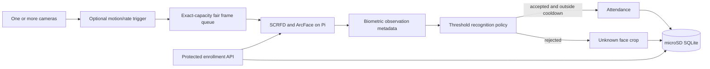

# Architecture

The inference worker is deliberately single-consumer by default. Camera capture remains concurrent, while an exact-capacity fair queue prevents camera starvation and replaces stale same-camera frames under pressure. Queue age, inference latency, dropped frames, and camera health are exposed by `/health`.

Enrollment and recognition share one model instance and lock. Active compatible embeddings are loaded into an immutable RAM catalog and refreshed after enrollment or status changes. The compatibility key fingerprints the actual ONNX bytes and manifest contract.

SQLite is authoritative. When `CLOUD_SUMMARY_ENABLED=true`, Firebase receives only camera health and confirmed attendance summaries. The cloud writer never uploads enrollment images, unknown images, embeddings, or calibration data.

Each face is decided independently. Multiple faces in a frame do not share a session or identity vote. This policy is not liveness detection; production spoof resistance still requires a separately validated control.
