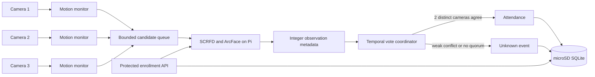

# Architecture

The inference worker is deliberately single-consumer by default. Camera capture remains concurrent, while bounded queuing prevents the old behavior in which an event was immediately discarded whenever another inference held the model lock. Queue pressure is counted and persisted as camera health metadata.

Enrollment and recognition share one model instance and lock. This avoids loading a second model copy into the Pi's limited memory and guarantees that enrollment embeddings use the same model version as recognition.

SQLite is authoritative. When `CLOUD_SUMMARY_ENABLED=true`, Firebase receives only camera health and confirmed attendance summaries. The cloud writer never uploads enrollment images, unknown images, embeddings, or calibration data.

## Current operational assumption

The vote window models one person passing through the monitored zone at a time. Simultaneous people require cross-camera tracking or a physical single-file entrance. Do not claim multi-person cross-camera association until that extension has been implemented and tested.
